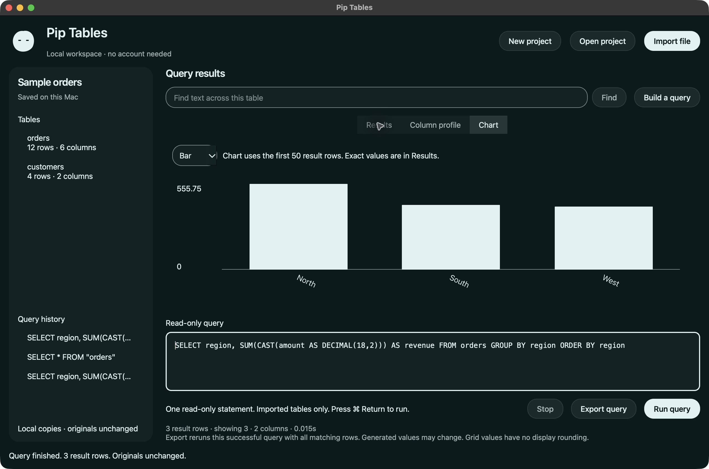

# Pip Tables: local CSV, Excel and Parquet analysis

A local desktop workbench for the question behind your spreadsheet. Import a file, inspect its columns, build a query and keep the result with its source.

**Experimental macOS Apple Silicon alpha.** The core needs no account, internet connection, model or paid service. It is an original implementation inspired by familiar data-analysis workflows. It is not affiliated with Julius or Duckling.



## Four configurations

One engine, two appearances and an explicit Plus feature set. Core and Plus use the same format-2 projects, which you open deliberately. Each package has its own app identity; Pip appearance preferences are separate between Core and Plus. Switching versions never automatically replaces a project.

| Package | Features | Source launch | Build |
| --- | --- | --- | --- |
| Tables Baseline | Core, native system appearance | `--edition baseline` | `scripts/build.py baseline` |
| Pip Tables | Core, original Pip themes/motion | `--edition pip` | `scripts/build.py pip` |
| Tables Baseline Plus | Core + import inspection and result pages | `--edition baseline --enhanced` | `scripts/build.py baseline-plus` |
| Pip Tables Plus | Same extras, Pip appearance | `--edition pip --enhanced` | `scripts/build.py pip-plus` |

Core is version 0.1.0-alpha.1; Plus is 0.2.0-alpha.1. Release notes identify the exact tested assets. The neutral appearance is our original implementation; no vendor source, branding or assets are copied.

```sh
python3.13 -m venv .venv
.venv/bin/python -m pip install -r requirements-lock.txt
.venv/bin/python -m pip_tables --edition pip
# Plus:
.venv/bin/python -m pip_tables --edition pip --enhanced
```

Use Python 3.13 on macOS 13 or newer, arm64. The package recipe is currently macOS arm64 only. Dependencies download from PyPI during setup; the application does not download anything at runtime. Allow about 1 GB for source dependencies/builds. No administrator access or global security setting change is needed for source setup.

## First useful result

1. Press **New project**, choose an empty folder, then **Import file** and select `examples/orders.csv`.
2. Select `orders` in Tables. Inspect Results and Column profile. Search matches literal text; press a column header to sort.
3. Press **Build a query** for a summary, join, pivot or explicit type conversion. The query is shown for you to check before running.
4. Try the regional-revenue example in [examples](examples/README.md), then open Chart. Exact values remain in Results.
5. Press **Export query**, choose a new destination outside the project. Export reruns the last successful query with all matching rows, even when only the first 1,000 are shown. Existing files are never replaced. Time/random-generated values may differ because export reruns the query; it is not a frozen result snapshot.

Plus inspects up to 20 rows with the actual inferred types before you confirm import; Excel sheets appear in a picker. Inspection stages up to 1,000,001 rows in a temporary local database and rejects files overone million rows and removes it afterward. A source hash is checked again before/after import; changed sources require reinspection. Large inspections can take time and disk space. Core imports directly after its options dialog.

Plus also offers Previous/Next rows in pages of 1,000. The row range and exact count stay visible; navigation adds no query-history entries. Pages rerun the query, so use `ORDER BY` for an order. Generated/changing values can move across pages; a frozen paged snapshot is not promised. Export still reruns the full successful query. A failed page keeps the previous displayed page.

Open the project folder later to restore imported tables, history and your query draft. Source files can move after import; data snapshots remain in the project. Pressing history recalls a query for review; it does not run it automatically. ⌘ Return runs, ⌘ I imports, ⌘ O opens a project, and ⌘ E exports. Stop interrupts running work; an in-progress window refuses to close until work has stopped safely.

## What works and its boundaries

CSV (UTF-8/BOM, UTF-16, Latin-1), selected-sheet XLSX, JSON/NDJSON and Parquet imports. Schema and missing/distinct/min/max profiling. Read-only DuckDB SQL for filters, transformations, joins, grouped summaries and pivots. Categorical bar/line/point charts use the first two columns and at most 50 rows; the grid provides exact values. CSV/XLSX/JSON/Parquet exports, durable local projects and successful-query history.

Preview is capped at 1,000 rows, 512 columns, 8 MiB and 1 MiB per cell. Queries/profiles have 10-second deadlines; imports/exports have cooperative120-second deadlines and a one-million-row limit. XLSX preflight caps expanded contents at 256 MiB, shared strings at 16 MiB and each worksheet XML at 128 MiB. Stop/deadline waits for any in-progress Python parser call before reporting. Exports allow up to one million rows and 120 seconds. The native engine has a 512 MB working-memory limit and disk spill is disabled. Large or complex inputs may fail safely; this is not an unlimited warehouse. No natural-language assistant, spreadsheet cell editing, macros, remote database connections or provider sign-in is included.

Excel formula cells are rejected on import. Export values from your spreadsheet first. A multi-sheet workbook needs an explicit sheet name. CSV can be kept as text; use visible `TRY_CAST`/date functions to choose types. Mixed wide-integer/fractional Excel columns remain text rather than losing significant digits. JSON decimal/date/UUID/binary values use exact text/ISO/hex; nonfinite values become null. Excel writes exact decimals/large integers and nested values as text and rejects oversized cells. Formula-like CSV/XLSX text receives an apostrophe prefix for safety. Use Parquet for typed roundtrips; these formats are not interchangeable archives.

## Privacy, recovery and permissions

Only files you select enter a project. `data.duckdb` holds imported snapshots and source paths; `project.json` holds draft/history. Both contain your data in plaintext. Back up the whole folder to preserve it; remove the folder yourself when no longer needed. There is no hidden cloud copy or telemetry. Source inputs and existing export destinations are protected. A failed query keeps the last successful result. Project writes and completed exports are atomic. An invalid/corrupt/older project is rejected without changing it; keep a copy and report a synthetic reproduction. Format 2 is the first released format; unreleased format-1 development fixtures require their original checkout.

The app requests no microphone, screen-recording, accessibility or account permission. macOS may ask for ordinary selected-folder access. Binary builds are ad-hoc signed locally, without an Apple developer certificate or notarisation. Prefer the source setup if Gatekeeper blocks a downloaded build; do not disable system security globally. Native VoiceOver and a second Mac remain separate acceptance checks.

## Verify and build

```sh
.venv/bin/python -m pytest -q
.venv/bin/python -m pip check
.venv/bin/python -m pip_tables --smoke /tmp/tables-smoke.json
.venv/bin/python scripts/build.py baseline
.venv/bin/python scripts/build.py pip
.venv/bin/python scripts/build.py baseline-plus
.venv/bin/python scripts/build.py pip-plus
```

Builds are in `dist/`. A clean virtual environment is required for release builds. `dependency-inventory.json` records only declared runtime distributions and actual bundled Mach-O load commands; build tools are separately pinned in the lockfile. This is functional reproduction, not a promise of byte-identical signatures across hosts. See [verification](docs/VERIFICATION.md) for exact tested limits. Tests include headless Qt integration; they do not imply native accessibility acceptance. [AI setup](docs/AI-SETUP.md) gives a short copyable setup request. [Change notes](CHANGELOG.md), [security](SECURITY.md), [contributing](CONTRIBUTING.md) and [third-party licences](THIRD-PARTY-NOTICES.md) explain the maintenance boundary.

## About and references

Maintained by [Ghostzy0](https://github.com/Ghostzy0). MIT original application, with dynamically linked LGPLv3 Qt/PySide libraries and MIT DuckDB/openpyxl. No private reference recordings, proprietary motion code or model weights are shipped. [Foundation notes](UPSTREAM.md) document exact versions and the original-implementation decision.

[Julius](https://julius.ai/faq/chat-start-guide) is a workflow reference; a bounded free-account synthetic analysis matched the documented numerical oracle. File upload and actual downloaded output remain unverified. [Duckling](https://github.com/l1xnan/duckling/tree/02f9696bd57e554af1e370440928a4f1c79f420e) is an MIT desktop SQL reference, not an imported foundation. [DuckDB](https://github.com/duckdb/duckdb/tree/v1.4.3) provides the embedded query engine. No complete reference-parity or production-readiness claim is made.

[FAQ](docs/FAQ.md) · [How to analyse a file](docs/HOW-TO.md) · [Projects and upgrades](docs/PROJECTS-AND-UPGRADES.md) · [Source and releases](https://github.com/Ghostzy0/pip-tables)
